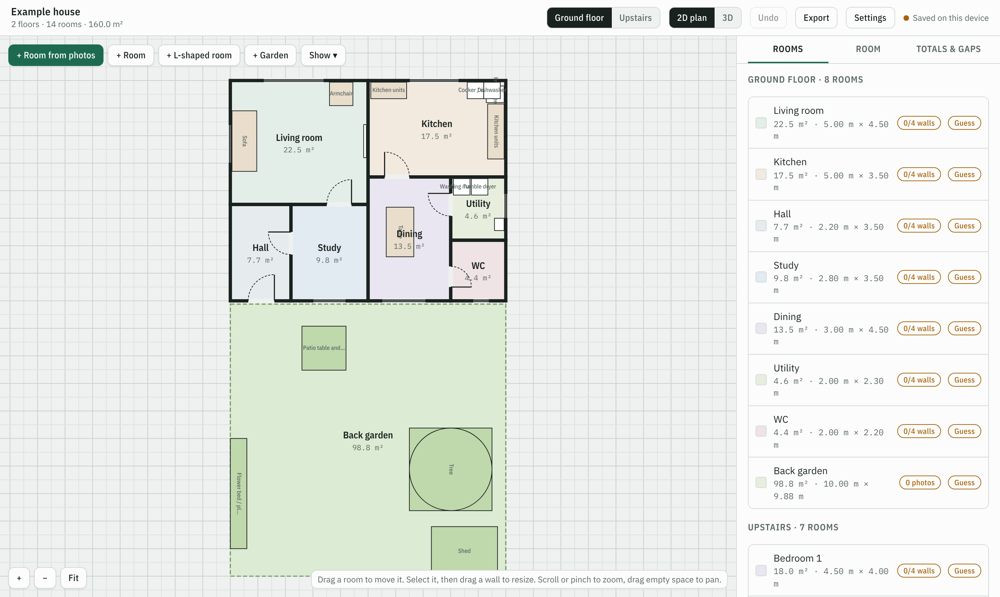
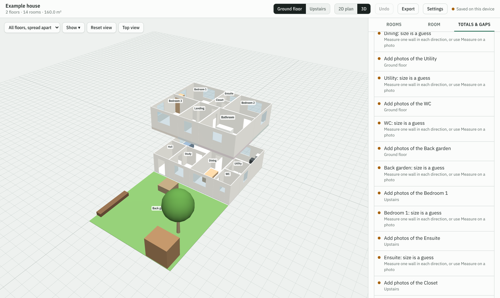
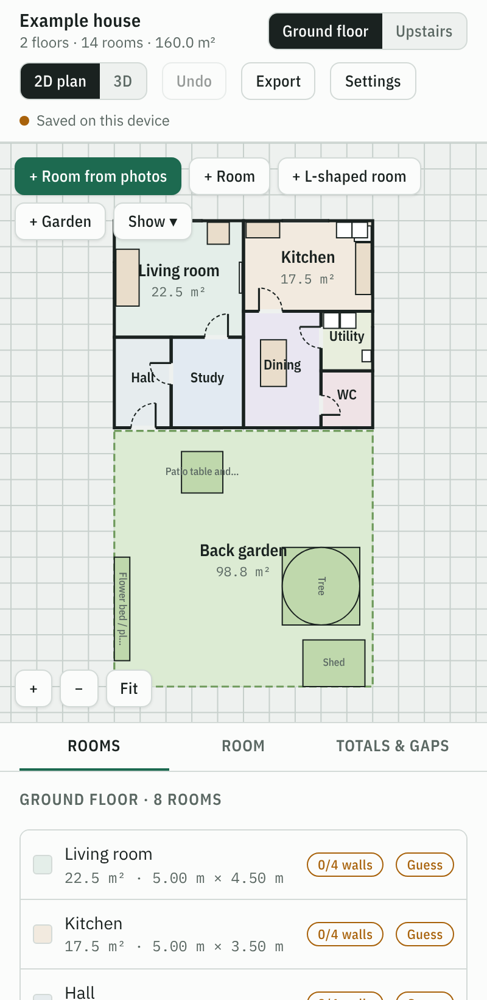
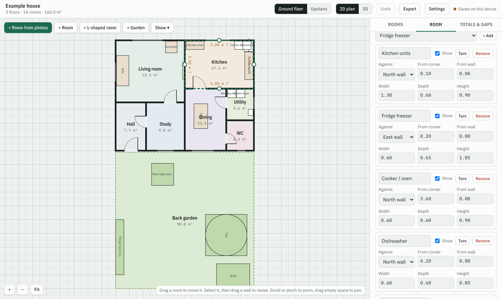
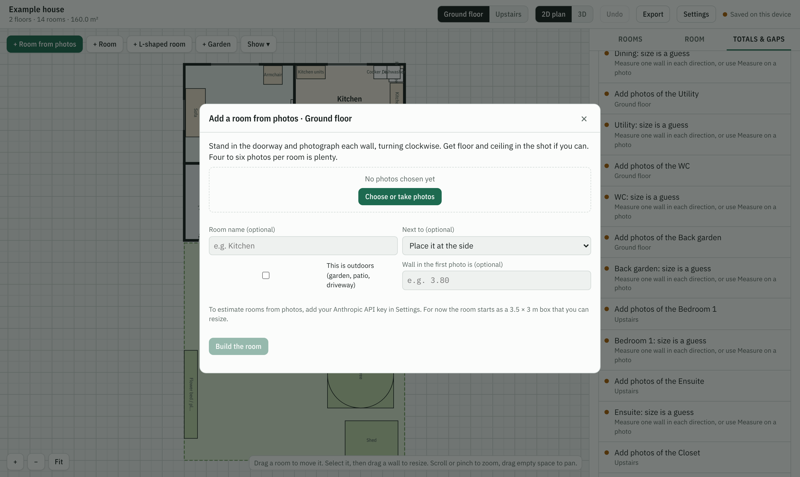

# House Plan Studio

Build a floor plan of your house from photos and a few measurements. Works in the browser on Android and Windows, installs as an app, and runs offline.

**Open it:** https://nichevo.github.io/house-plan-studio/



| 3D view you can orbit | On a phone |
|---|---|
|  |  |

| Appliances and furniture in a room | Building a room from photos |
|---|---|
|  |  |

*Screenshots show the built-in example house.*

## Install
- **Android (Chrome):** open the link, then tap **Install app** in the top bar (or menu ⋮ → *Install app*).
- **Windows (Chrome or Edge):** open the link, then click **Install app** in the top bar (or the install icon in the address bar).

## What it does
- Rooms and garden areas on each floor, built from photos or drawn by hand, with drag-to-resize walls.
- Doors, windows, appliances and furniture, some detected from your photos.
- Automatic floor area, wall (paint) area, volume and per-floor totals, plus a list of what's still missing.
- 2D plan and a 3D view you can orbit. Layers for appliances, furniture, garden and photos.
- Exports: PNG, SVG, PDF, CSV, a 3D model (GLB + OBJ), and a project zip with photos to move work between devices.

## Rooms from photos
Building rooms and finding appliances from photos uses Claude. Add your own Anthropic API key in **Settings** (get one at console.anthropic.com). The key stays in your browser and is sent only to Anthropic. Everything else works without a key.

## Your data
Plans and photos are stored in the browser on each device. Use **Export → Save project with photos** for backups and to move between phone and computer.

## Building
`src/house.html` is the app and `src/shell-head.html` adds the installable-app layer. To rebuild the files at the repo root:

```
python3 src/build.py src/house.html && cp src/dist/* .
```
